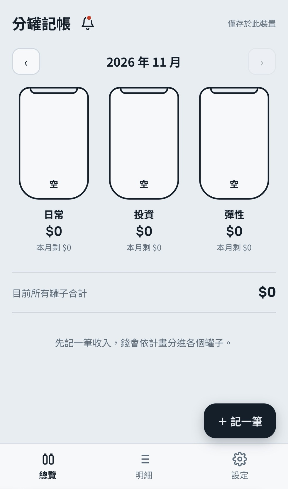

# 分罐記帳 Bottle-keeping

把每個月的收入分進不同的罐子，每一筆花費都從對應的罐子扣，隨時知道每個罐子還剩多少錢。

  

**線上版本**：<https://stty0219.github.io/Bottle-keeping/>
用手機瀏覽器開啟後選「加入主畫面」，就能像一般 App 一樣使用，沒有網路時也能記帳。

---

## 為什麼做這個

市面上的記帳 App 很多，但用起來總有些地方不順手：

- **訂閱費與付費功能**：基本功能免費，真正想用的功能（多帳本、預算、匯出、雲端同步）卻要付費或訂閱。
- **不夠客製化**：分類、預算、報表的方式都是 App 決定好的，很難照自己的習慣調整。
- **人配合 App，而不是 App 配合人**：為了使用某個 App，得改變自己原本管錢的方式，用久了反而更累。
- **只記錄花了多少**：大多數 App 擅長告訴你「這個月花了多少」，卻很難一眼看出「生活費還剩多少」「這個月還能存多少」。
- **共同開銷不好管理**：和另一半一起負擔的開銷，往往只能各記各的，或靠事後對帳。

所以我做了分罐記帳：把每個月的收入分進不同的罐子，每一筆花費都從對應的罐子扣，每個罐子還剩多少一目了然；也能和另一半開一個共用罐，一起負擔共同的開銷。
所有功能都照自己的使用習慣設計，發現哪裡不順手，就直接改。

---

## 主要功能

- **罐子與每月分配**：為每個罐子設定每月金額（例如日常、儲蓄、彈性），收入記下後自動分進各個罐子；獎金之類的收入也可以全部放進同一個罐子。
- **結轉與月底結算**：罐子可以設定把剩下的錢帶到下個月，或每月歸零；歸零罐子的剩餘或不足，會在月底結算進指定的罐子。
- **超支墊付**：罐子花超過時，可以指定由另一個罐子補上，不會讓帳面出現說不清的負數。
- **共用罐**：用 Email 邀請另一半一起維護一個罐子，各自每月撥款進去，共同開銷都從這裡扣；超支時依人數平分。
- **快速記帳**：計算機鍵盤可以直接輸入算式，常用分類排在最前面。
- **明細**：每日支出、支出比例圓餅圖、備註關鍵字搜尋，左滑刪除後還能復原。
- **月結算**：每個月結束後，可以看到收支總覽、分類支出排行、各罐子的成績與評等。
- **資料備份**：匯出或還原 JSON 備份，也能匯出 CSV。
- **回報問題**：在 App 裡回報問題或提出建議，並查看處理進度。

## 特色

- **不使用框架與建置工具**：只有 HTML、CSS、JavaScript 檔案，改完直接重新整理就能看到結果。
- **離線可用**：沒有網路時照常記帳，連線後自動同步。
- **多裝置即時同步**：手機、平板、電腦登入同一個帳號，資料即時更新。
- **共用罐**：個人的錢和共同的錢分開管理，又能在同一個畫面看到。
- **結算風格**：月結算有 7 種風格可以選擇，評語與稱號都能自訂。
- **深色模式與動態效果設定**：跟著系統切換深色模式；動態效果可以選標準、減少或關閉。

## 技術棧

- HTML / CSS / JavaScript
- Firebase（Authentication、Firestore）
- GitHub Pages

## 文件

| 文件 | 內容 |
|---|---|
| [docs/architecture.md](docs/architecture.md) | 技術架構、檔案結構與職責、script 載入順序、資料結構 |
| [docs/calculation-rules.md](docs/calculation-rules.md) | 計算規則：每月分配、結轉、月底結算、超支墊付、共用罐、個人支出、評等 |
| [docs/deployment.md](docs/deployment.md) | 部署：GitHub Pages、Firebase 設定、安全規則、本機測試 |
| [docs/development.md](docs/development.md) | 開發流程：分支、commit、PR、改版步驟、測試清單 |

## 最新版本

**v39**（2026-11-19）

- 修正：撥給共用罐的錢導致所屬罐子超支時，會像一般超支一樣，由該罐子設定的墊付罐子補上。

更早的版本可以在 App 的開發者選項「更新紀錄」中查看（在設定頁連點版本號 7 次開啟開發者選項）。
